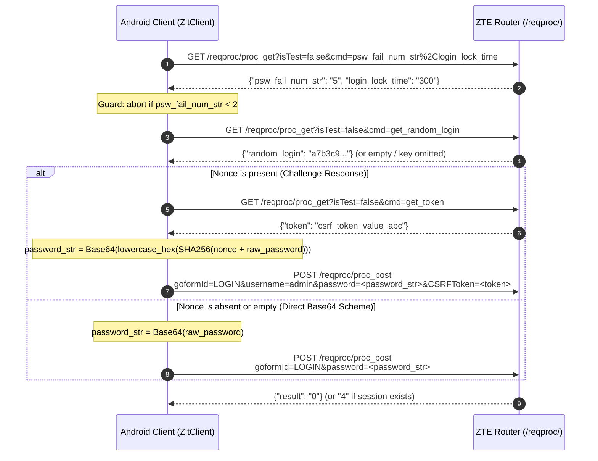
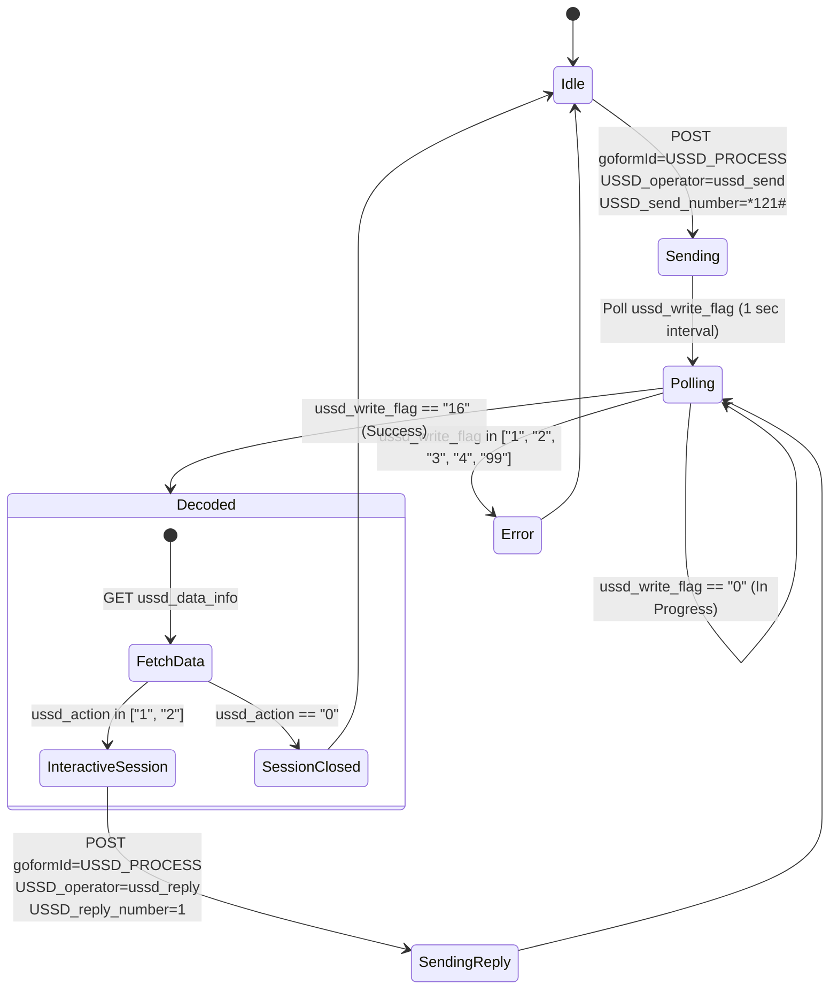

# ZTE / Vemo 4G MiFi `reqproc` Protocol Specification

This document provides a comprehensive, reverse-engineered specification of the HTTP-based administration API powering ZTE mobile hotspot devices, specifically the **ZTE U30S+**, **Vemo 4G MiFi**, and related **ZLT T10D MAX / ZXIC** chipsets running embedded Linux/eCos web servers.

---

## 1. Architectural Overview & Wire Transport

The router hosts an embedded, single-threaded HTTP daemon that exposes two primary RPC endpoints under `/reqproc/`:

| Endpoint | Method | Purpose | Typical Content Type |
|---|---|---|---|
| `/reqproc/proc_get` | `GET` | Telemetry, status readings, and configuration queries | `application/json` |
| `/reqproc/proc_post` | `POST` | Mutations, authentication, controls, and triggers | `application/x-www-form-urlencoded; charset=UTF-8` |

### Mandatory HTTP Headers
The router's web server validates origin and request headers. Requests lacking these headers can be dropped or rejected with HTTP 403 / 400:

```http
Referer: http://<ROUTER_IP>/index.html
X-Requested-With: XMLHttpRequest
User-Agent: Mozilla/5.0 (Android; Mobile) ZTECompanion/1.0
```

> [!WARNING]
> **Single-Threaded Embedded Server**: The device's internal web daemon runs on a lightweight CPU. Concurrent HTTP requests will result in connection resets (`ECONNRESET`), socket exhaustion, or race conditions during authentication handshakes. **All client calls must be strictly serialized via a Mutex lock.**

---

## 2. Authentication & Session Management

The ZTE modem supports two authentication patterns depending on the exact firmware build:
1. **Challenge-Response SHA-256 Nonce Scheme** (Standard modern ZLT / ZTE firmware)
2. **Direct Base64 Password Scheme** (Common on stock ZTE U30S+ and Vemo 4G WebUIs)

### 2.1 The 4-Step Authentication Handshake



### 2.2 Password Digest Computation

#### Challenge-Response Scheme:
$$\text{password\_param} = \text{Base64}\Big(\text{US-ASCII}\big(\text{hex\_lowercase}(\text{SHA-256}(\text{nonce} + \text{password}))\big)\Big)$$

* **Critical Implementation Gotcha**: The SHA-256 output is first converted into a **64-character lowercase hexadecimal ASCII string**. Then, that 64-character string is Base64-encoded.
* Encoding the raw 32-byte digest binary gives an invalid 44-character Base64 string that will be rejected by the router.

#### Direct Base64 Scheme:
$$\text{password\_param} = \text{Base64}(\text{UTF-8}(\text{password}))$$

### 2.3 Hardware Lockout Counters & Guard

* Key: `psw_fail_num_str`
  * Represents **attempts remaining**, *not* failure count.
  * Fresh state: `"5"`.
  * Lockout triggers when it reaches `"0"`.
* Key: `login_lock_time`
  * The lockout penalty duration in seconds (typically `300` seconds / 5 minutes).
* **Client Guard Rule**:
  ```kotlin
  if (attemptsRemaining < 2) {
      throw LockedOut(attemptsRemaining, lockSeconds)
  }
  ```
  The app must refuse to attempt authentication if fewer than 2 attempts remain, preventing accidental lockouts due to typo retries.

### 2.4 Login Response Codes
* `"0"`: Fresh successful login; new session initialized.
* `"4"`: Success (a valid session was already active).
* `"1"` / `"failure"`: Invalid credentials.
* `AUTH_FAIL_MARKERS`: `["no_session", "session_error", "need_login", "not_login", "-1"]`.

---

## 3. Query Protocol: `GET /reqproc/proc_get`

### 3.1 URL Structure
```http
GET /reqproc/proc_get?isTest=false&multi_data=1&cmd=<key1>%2C<key2>%2C<keyN> HTTP/1.1
```
* `cmd`: Comma-separated list of telemetry keys, percent-encoded as `%2C`.
* `multi_data=1`: Required whenever more than one key is requested.
* Additional parameters (e.g., for pagination) can be appended directly.

### 3.2 Key Categories & Dictionary

#### Unauthenticated (Open) Keys
Can be queried prior to login:
* `network_type`: Current radio technology (`"LTE"`, `"HSPA"`, `"WCDMA"`, `"EDGE"`, `"No Service"`).
* `network_provider`: Cellular carrier name (e.g., `"GrameenPhone"`, `"Skitto"`, `"MTN"`).
* `wan_ipaddr`: Public or CGNAT IPv4 address assigned to the cellular interface.
* `ppp_status`: Connection status (`"ppp_connected"`, `"ppp_connecting"`, `"ppp_disconnected"`).
* `rssi`: Received Signal Strength Indicator in dBm (e.g., `"-58"`).
* `signalbar`: Device bar rating from `0` to `5`.
* `lte_rsrq`: Reference Signal Received Quality in dB (e.g., `"-9"`).
* `lte_pci`: Physical Cell Identifier (e.g., `"204"`).
* `monthly_rx_bytes`: Total monthly download bytes (string of integer).
* `monthly_tx_bytes`: Total monthly upload bytes (string of integer).
* `realtime_rx_bytes`: Cumulative interface download bytes since boot.
* `realtime_tx_bytes`: Cumulative interface upload bytes since boot.
* `sms_unread_num`: Count of unread SMS messages stored on the SIM card.
* `wifi_cur_state`: Wi-Fi radio status (`"1"` = enabled, `"0"` = disabled).

#### Authenticated (Protected) Keys
Empty strings until an authenticated session cookie is established:
* `lte_rsrp`: Reference Signal Received Power in dBm (e.g., `"-78"`).
* `lte_band`: LTE operating frequency band (e.g., `"3"`, `"1"`, `"7"`, `"20"`).
* `lte_snr`: Signal-to-Noise Ratio in dB (e.g., `"14"`).

#### Network Mode Configuration Keys
* `net_select`: The active bearer mode (`"Only_LTE"`, `"NETWORK_auto"`, `"TD_W_LTE"`, `"TD_W"`, `"Only_GSM"`).
* `current_network_mode`: Operational radio state.
* `net_select_mode`, `m_netselect_save`: Fallback mode keys found on variant firmwares.

#### Hardware & SIM Keys
* `imei`: International Mobile Station Equipment Identity (15-digit decimal).
* `sim_imsi`: International Mobile Subscriber Identity of the inserted SIM card.
* `wa_inner_version`: Firmware revision string (e.g. `MX1SW1.0_U10S_FB_ZL_SL_V01.01...`).
* `hardware_version`: Board revision (e.g. `V1.0`).
* `battery_vol_percent`: Current battery charge percentage (`"0"` to `"100"`).
* `battery_charging`: Charging state (`"1"` = charging, `"0"` = discharging).

---

## 4. Command Protocol: `POST /reqproc/proc_post`

All write mutations are dispatched as URL-encoded form data to `/reqproc/proc_post`. Every write payload must include:
* `isTest=false`
* `goformId=<ACTION_IDENTIFIER>`
* `CSRFToken=<token>` (if a token was provided during handshake)

### 4.1 Radio & Network Mode (`SET_BEARER_PREFERENCE`)
Switches cellular network generation preference:
```http
POST /reqproc/proc_post HTTP/1.1
Content-Type: application/x-www-form-urlencoded; charset=UTF-8

isTest=false&goformId=SET_BEARER_PREFERENCE&BearerPreference=Only_LTE&CSRFToken=...
```

#### Supported Values
| Mode Name | Parameter Value | Description |
|---|---|---|
| **Automatic** | `NETWORK_auto` | Multi-mode auto-selection across all generations |
| **4G LTE Only** | `Only_LTE` | Lock radio exclusively to 4G LTE |
| **4G and 3G** | `TD_W_LTE` | Allow LTE and WCDMA/HSPA, disallowing 2G GSM |
| **3G Only** | `TD_W` | Lock radio exclusively to 3G UMTS/HSPA (Note: `TD_W`, *not* `Only_WCDMA`) |
| **2G Only** | `Only_GSM` | Lock radio exclusively to 2G GSM/GPRS/EDGE |

### 4.2 Cellular Packet Data Connection
* **Connect Cellular Data**:
  ```http
  isTest=false&goformId=CONNECT_NETWORK&notCallback=true
  ```
* **Disconnect Cellular Data**:
  ```http
  isTest=false&goformId=DISCONNECT_NETWORK&notCallback=true
  ```

---

## 5. Dual-Band Wi-Fi Configuration

The ZTE / Vemo platform handles Wi-Fi configurations through distinct parameter namespaces for 2.4 GHz vs 5 GHz.

### 5.1 Band Parameter Mapping

| Attribute | 2.4 GHz Radio (802.11b/g/n) | 5 GHz Radio (802.11a/ac) |
|---|---|---|
| **Band Identifier (`wifi_band`)** | `"b"` | `"a"` |
| **SSID Key** | `SSID1` | `SSID1_5g` |
| **Passphrase Key** | `WPAPSK1` | `WPAPSK1_5g` |
| **Security Mode** | `AuthMode` | `AuthMode_5g` |
| **Max Connected Stations** | `MAX_Access_num` | `MAX_Access_num_5g` |
| **SSID Broadcast Suppression** | `HideSSID` (`0`=visible, `1`=hidden) | `HideSSID_5g` (`0`=visible, `1`=hidden) |

### 5.2 Wi-Fi Mutating Actions
* **Toggle Master Wi-Fi Power**:
  ```http
  isTest=false&goformId=SET_WIFI_INFO&wifiEnabled=1
  ```
  *(Set `wifiEnabled=0` to shut down Wi-Fi radios)*

* **Update Wi-Fi SSID & Passphrase**:
  ```http
  isTest=false&goformId=SET_WIFI_SSID1_SETTINGS&ssid=MyNetwork&passphrase=<Base64_Encoded_Password>&security_mode=WPA2PSK
  ```
  *Note*: For 5 GHz-only update on dual-band firmwares, target `goformId=SET_WIFI_SSID1_SETTINGS_5G` or pass `wifi_band=a`.

* **Wi-Fi Power-Saving Idle Sleep**:
  ```http
  isTest=false&goformId=SET_WIFI_SLEEP_INFO&Sleep_interval=10
  ```
  *(Sleep interval in minutes; `0` disables sleep).*

### 5.3 Connected Station List (`station_list`)
Queried via `GET /reqproc/proc_get?isTest=false&cmd=station_list`:
```json
{
  "station_list": [
    {
      "hostname": "Android-Pixel-8",
      "ip_addr": "192.168.0.101",
      "mac_addr": "AA:BB:CC:DD:EE:FF",
      "dev_type": "wifi",
      "ip_type": "DHCP",
      "connect_time": "01:45:22"
    }
  ]
}
```

---

## 6. Data Volume Limit & Flow Calibration

### 6.1 Querying Usage Counters
Counters are retrieved in bytes using:
```http
GET /reqproc/proc_get?isTest=false&multi_data=1&cmd=monthly_rx_bytes%2Cmonthly_tx_bytes%2Crealtime_rx_bytes%2Crealtime_tx_bytes
```
$$\text{Total Monthly Usage} = \text{monthly\_rx\_bytes} + \text{monthly\_tx\_bytes}$$

### 6.2 Data Limit Configuration (`DATA_LIMIT_SETTING`)
Configures hardware quota enforcement:
```http
POST /reqproc/proc_post HTTP/1.1

isTest=false&goformId=DATA_LIMIT_SETTING&data_volume_limit_switch=1&data_volume_limit_size=51200&data_volume_limit_unit=MB&data_volume_limit_action=disconnect
```

* `data_volume_limit_switch`: `"1"` to enable, `"0"` to disable.
* `data_volume_limit_size`: Threshold numerical value.
* `data_volume_limit_unit`: `"MB"` or `"GB"`.
* `data_volume_limit_action`: `"disconnect"` (shut off data) or `"notice"` (trigger alert flag).

### 6.3 Data Counter Reset & Calibration (`FLOW_CALIBRATION_MANUAL`)
When a new billing cycle begins or manual zeroing is required:
```http
POST /reqproc/proc_post HTTP/1.1

isTest=false&goformId=FLOW_CALIBRATION_MANUAL&clear_traffic=1&notCallback=true
```

---

## 7. SMS Messaging Protocol & UCS-2 Codec

The router stores SMS messages directly in SIM non-volatile memory. 

### 7.1 Reading Messages (`sms_data_total`)
```http
GET /reqproc/proc_get?isTest=false&cmd=sms_data_total&page=0&data_per_page=50&mem_store=1&tags=10&order_by=order+by+id+desc
```

#### Sample Response:
```json
{
  "messages": [
    {
      "id": "31",
      "number": "skitto info",
      "content": "003C0023003E0020098609AA09A809BE09B0",
      "tag": "1",
      "date": "26,11,05,03,41,56,+24"
    }
  ]
}
```
* `tag`: `"1"` = Unread, `"0"` = Read.
* `date`: Format is `yy,MM,dd,HH,mm,ss,+tz` or `yy;MM;dd;HH;mm;ss;+tz`.

### 7.2 UCS-2 / UTF-16 BE Hex Encoding for Bengali & International Text
SMS message bodies are represented as big-endian hexadecimal strings:
* Each UTF-16 character maps to exactly 4 hex characters:
  $$\text{'A'} \to \text{0x0041} \to \text{"0041"}$$
  $$\text{'ক'} (\text{Bengali Ka}) \to \text{0x0995} \to \text{"0995"}$$
* **Special Filter**: ZTE modems occasionally insert null padding (`0000`) or tab bytes (`0009`). The client decoder explicitly skips these sequences to prevent rendering corruption.

### 7.3 Sending SMS (`SEND_SMS`)
```http
POST /reqproc/proc_post HTTP/1.1

isTest=false&goformId=SEND_SMS&Number=+8801700000000&sms_time=26%3B11%3B06%3B18%3B00%3B00%3B%2B24&MessageBody=00480065006C006C006F&ID=-1&encode_type=UNICODE&notCallback=true
```
* `sms_time`: Formatted as `yy;MM;dd;HH;mm;ss;+tz`.
* `encode_type`: Must be `"UNICODE"`.

### 7.4 Deleting SMS (`DELETE_SMS`)
```http
POST /reqproc/proc_post HTTP/1.1

isTest=false&goformId=DELETE_SMS&msg_id=31%3B&notCallback=true
```
* `msg_id`: Message ID terminated with a semicolon (e.g. `"31;"`). Multiple IDs can be batched: `"31;32;33;"`.

---

## 8. Interactive USSD Protocol & State Machine

USSD on ZTE hardware is handled via an asynchronous request-and-poll cycle.



### 8.1 Dispatching USSD Command
* **Initial USSD Command**:
  ```http
  POST /reqproc/proc_post HTTP/1.1
  isTest=false&goformId=USSD_PROCESS&USSD_operator=ussd_send&USSD_send_number=*121%23&notCallback=true
  ```
* **Reply to Active Session**:
  ```http
  POST /reqproc/proc_post HTTP/1.1
  isTest=false&goformId=USSD_PROCESS&USSD_operator=ussd_reply&USSD_reply_number=1&notCallback=true
  ```

### 8.2 Status Polling: `ussd_write_flag`
The client polls `GET /reqproc/proc_get?isTest=false&cmd=ussd_write_flag` every 1000ms:
* `"16"`: **Success**: Response payload is ready.
* `"0"`: Network request pending.
* `"1"`: Request timed out.
* `"2"`: Command rejected or invalid syntax.
* `"3"`: Terminated by mobile network.
* `"4"`: USSD service not supported by operator.
* `"99"`: General failure.

### 8.3 Fetching USSD Result: `ussd_data_info`
When flag is `"16"`, query `GET /reqproc/proc_get?isTest=false&cmd=ussd_data_info`:
```json
{
  "ussd_data": "0059006F00750072002000420061006C0061006E0063006500200069007300200035003000200054006B",
  "ussd_action": "1"
}
```
* `ussd_data`: Hex-encoded UCS-2 string (decoded via `SmsCodec.decodeHex`).
* `ussd_action`:
  * `"1"` or `"2"`: **Session remains OPEN** (router expects user reply).
  * `"0"`: **Session CLOSED** (terminal message).

---

## 9. System Management & Tooling

### 9.1 Device Reboot (`REBOOT_DEVICE`)
```http
POST /reqproc/proc_post HTTP/1.1
isTest=false&goformId=REBOOT_DEVICE
```

### 9.2 Factory Reset (`RESTORE_FACTORY_SETTINGS`)
```http
POST /reqproc/proc_post HTTP/1.1
isTest=false&goformId=RESTORE_FACTORY_SETTINGS
```

### 9.3 Change Web Admin Password (`CHANGE_PASSWORD`)
```http
POST /reqproc/proc_post HTTP/1.1
isTest=false&goformId=CHANGE_PASSWORD&oldPassword=<Base64_Old>&newPassword=<Base64_New>
```

### 9.4 Custom APN Configuration (`APN_PROC_EX`)
```http
POST /reqproc/proc_post HTTP/1.1
isTest=false&goformId=APN_PROC_EX&apn_action=save&apn_mode=manual&profile_name=MyAPN&wan_apn=internet&ppp_auth_mode=NONE&pdp_type=IP&wan_dial=*99%23&index=1

POST /reqproc/proc_post HTTP/1.1
isTest=false&goformId=APN_PROC_EX&apn_action=set_default&apn_mode=manual&set_default_flag=1&index=1
```

### 9.5 LAN IP & DHCP Server (`DHCP_SETTING`)
```http
POST /reqproc/proc_post HTTP/1.1
isTest=false&goformId=DHCP_SETTING&lanIp=192.168.0.1&lanNetmask=255.255.255.0&lanDhcpType=SERVER&dhcpStart=192.168.0.100&dhcpEnd=192.168.0.200&dhcpLease=1&dhcp_reboot_flag=1
```
* Note: Applying new LAN settings triggers an automatic DHCP daemon restart and local interface reload.
